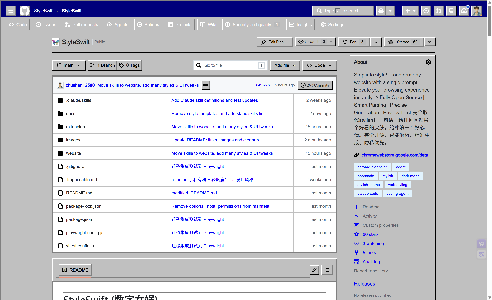
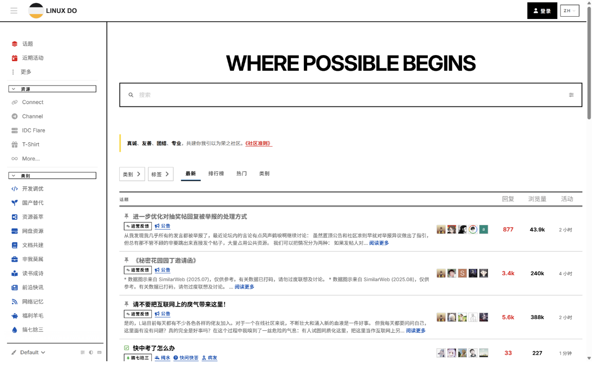
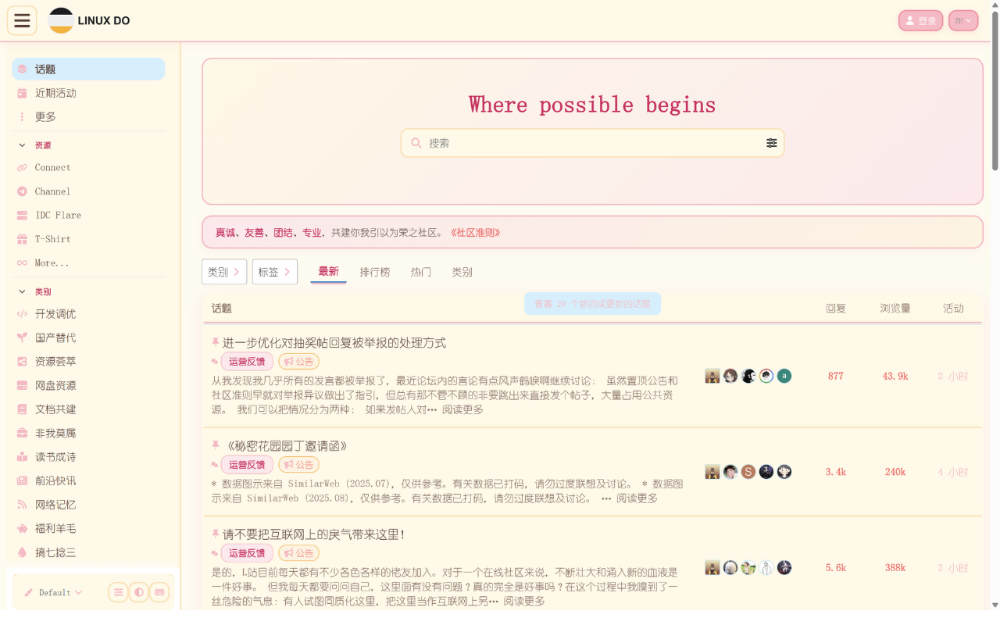
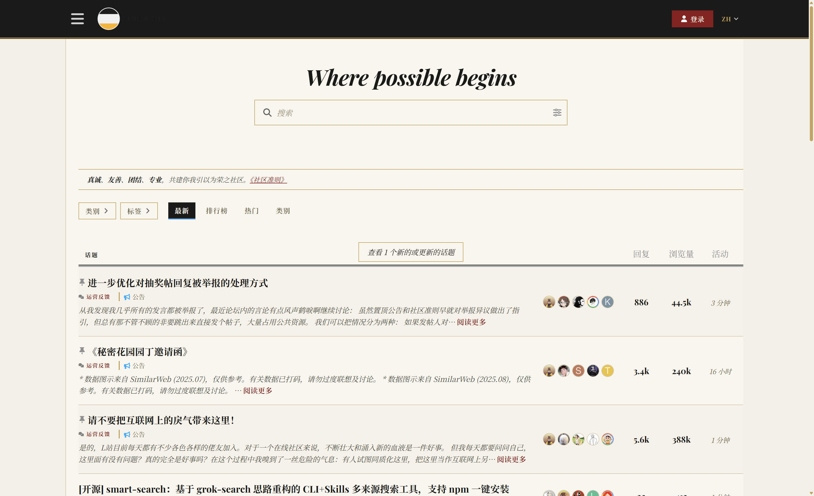
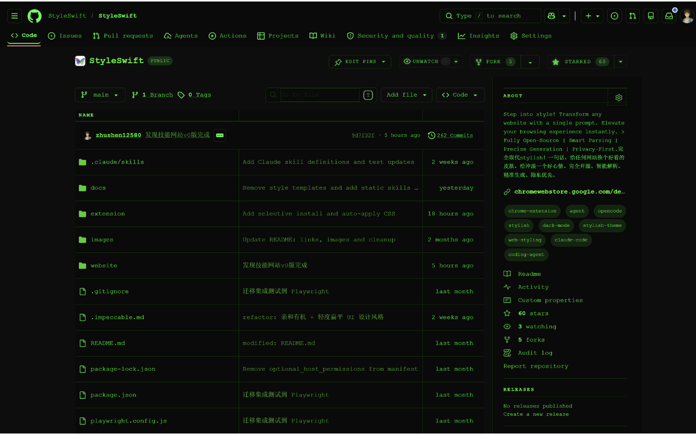
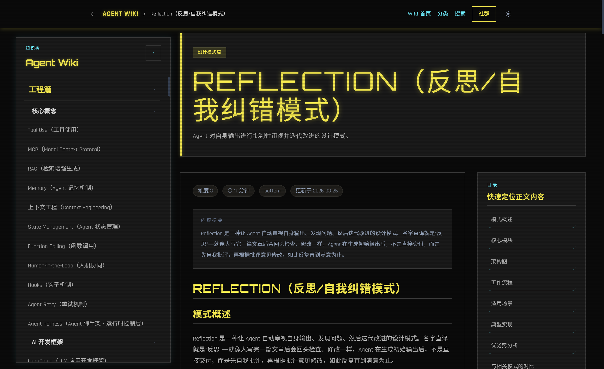

# StyleSwift (数字女娲)

<div align="center">


**Give your favorite websites a fresh look with a single sentence**

[](https://chromewebstore.google.com/detail/styleswift/llchggmimjgnbjlcgpkjmplhfbkjjcli) [](extension/manifest.json) [](docs/legal/LICENSE) [](https://github.com/StyleSwift/StyleSwift/actions/workflows/ci.yml) [](https://ppio.com/)

[English](#english) | [中文](#中文)

</div>

---

## English

### What is StyleSwift?

**StyleSwift is an AI Agent that transforms any website's appearance with a single sentence.**

Just describe what you want: "Make it look like The Matrix" or "Give me an e-ink reading mode". The Agent understands your intent, analyzes the page, and applies styles automatically.

### Highlights

| | |
|---|---|
| **Natural language styling** | Describe the look you want. The Agent plans its own steps, no preset workflows |
| **Autonomous page analysis** | The model fetches only what it needs (`get_page_structure`, `grep`) instead of dumping the whole page, which saves tokens |
| **Blends with the site** | Generated CSS works with the site's own styles, without visual glitches |
| **Visual quality loop** | A QualityAudit sub-agent screenshots the result, checks contrast and accessibility, and fixes what it finds |
| **Style skills** | Save a look you like, reuse it on other sites, export and import it as a `.md` file |
| **Page or site scope** | Apply a style to the current page only, or to the whole site |
| **Undo and on/off switch** | Persistent undo history, a per-site style switch, and a toolbar badge (`ON` / `OFF`) on styled sites |
| **Your choice of model** | Use your own API key, or the Claude Code / Codex already logged in on your computer |
| **Multi-turn sessions** | Per-site sessions, context management, history compression |

### Effect Preview

<div align="center">

 |  | 
:---:|:---:|:---:
**Windows XP Style** | **Bauhaus Style** | **Warm Style**

 |  | 
:---:|:---:|:---:
**Old Newspaper Style** | **The Matrix Style** | **Cyberpunk Style**

</div>

### Quick Start

#### 1. Install the extension

**Chrome Web Store**: https://chromewebstore.google.com/detail/styleswift/llchggmimjgnbjlcgpkjmplhfbkjjcli

**From source**:

```bash
git clone https://github.com/StyleSwift/StyleSwift.git
```

1. Go to `chrome://extensions/`
2. Enable "Developer mode"
3. Click "Load unpacked" and select the `extension` folder

#### 2. Choose an engine

**Option A: Built-in engine (API key)**

On first launch, pick a provider and paste your API key. Presets: PPIO, DeepSeek, Zhipu GLM, Alibaba Bailian, SiliconFlow, Anthropic, OpenAI, Google Gemini. Any OpenAI- or Anthropic-compatible endpoint works through "Custom".

**Option B: Local Claude Code / Codex (no API key)**

If [Claude Code](https://docs.anthropic.com/en/docs/claude-code) or [Codex](https://github.com/openai/codex) is installed and logged in on your computer, StyleSwift can use it through a small local bridge. Install the bridge (Node.js 18+):

```bash
npx -y styleswift-bridge@latest install
```

No Node.js? Windows (PowerShell):

```powershell
irm https://raw.githubusercontent.com/StyleSwift/StyleSwift/main/bridge/scripts/install.ps1 | iex
```

macOS / Linux:

```bash
curl -fsSL https://raw.githubusercontent.com/StyleSwift/StyleSwift/main/bridge/scripts/install.sh | sh
```

Then click "Check again" in the side panel, and switch engines with the switcher next to the input box.

- The CLI's own tools (shell, file access, web search) are turned off. It can only call StyleSwift's page tools.
- Unpacked extension: add `--extension-id <ID from chrome://extensions>` to the install command.
- Uninstall: `npx styleswift-bridge uninstall`. Details: [bridge/README.md](bridge/README.md).

#### 3. Start styling

1. Click the extension icon to open the side panel
2. Describe what you want:
   - "Give this page a dark mode"
   - "Make the navigation larger"
   - "Hide this ad" (pick the element with the element picker first)
3. Not happy? Undo, or turn the style off for this site
4. Like it? Save it as a style skill and use it on other sites

### How It Works

```
┌──────────────────── Side Panel ────────────────────┐
│  Agent loop: sessions · history · undo · scope     │
│    ├─ Built-in engine ──▶ LLM API (your key)       │
│    └─ Local engine ─────▶ styleswift-bridge        │
│                             └─▶ Claude Code / Codex│
│  Tools: get_page_structure · grep · apply_styles   │
│         edit_css · capture_screenshot · skills ... │
└──────────────────────────┬─────────────────────────┘
                           │
┌──────────────────────────▼─────────────────────────┐
│  Content Script: reads the page, injects CSS       │
└────────────────────────────────────────────────────┘
```

**Core design**: code provides atomic capabilities (tools); the model handles reasoning and decisions. Both engines share the same tools. See [ARCHITECTURE.md](docs/ARCHITECTURE.md) and the [ADRs](docs/ADR/).

### Development

```bash
npm install
npm test                  # unit tests (Vitest), extension + bridge
npm run lint              # ESLint
npm run test:integration  # Playwright, loads the extension in Chrome
```

```
extension/   Chrome extension (MV3): side panel, content scripts, service worker, skills, themes
bridge/      styleswift-bridge: Native Messaging host for local Claude Code / Codex
website/     Official website (FastAPI)
docs/        Architecture, ADRs, feature docs, legal
```

### Contributing

Issues and pull requests are welcome: [GitHub Issues](https://github.com/StyleSwift/StyleSwift/issues). Before your first pull request, please read the [Contributor License Agreement](docs/guides/CONTRIBUTING.md).

### License

Server Side Public License (SSPL), see [LICENSE](docs/legal/LICENSE). For commercial licensing, see [COMMERCIAL_LICENSE.md](docs/legal/COMMERCIAL_LICENSE.md). The `bridge/` package is MIT licensed.

### Acknowledgments

- [impeccable](https://github.com/pbakaus/impeccable): style generation quality
- [learn-claude-code](https://github.com/shareAI-lab/learn-claude-code): Agent design philosophy

---

## 中文

### 项目简介

**数字女娲 (StyleSwift) 是一个 AI Agent，一句话就能改变任何网站的外观。**

只需描述你的想法：「让它看起来像黑客帝国」或「给我一个墨水屏阅读模式」。Agent 会理解你的意图、分析页面、自动应用样式。

### 核心亮点

| | |
|---|---|
| **一句话改样式** | 描述你想要的效果，Agent 自主规划步骤，无需预设工作流 |
| **自主页面分析** | 模型按需获取页面信息（`get_page_structure`、`grep`），不导出全页，更省 Token |
| **与站点无缝衔接** | 生成的 CSS 与网站自身样式融合，无视觉瑕疵 |
| **视觉质检循环** | QualityAudit 子代理截图检查对比度、可访问性等问题，并自主修复 |
| **风格技能** | 保存喜欢的风格，在其他网站复用，支持导出 / 导入 `.md` 文件 |
| **页面级 / 全站作用域** | 样式可只作用于当前页面，也可作用于整个站点 |
| **撤销与开关** | 持久化撤销历史、按站点开关样式，已改样式的网站在工具栏图标上显示 `ON` / `OFF` |
| **模型自由选择** | 用自己的 API Key，或直接用本机已登录的 Claude Code / Codex |
| **多轮对话** | 按站点隔离会话、上下文管理、历史压缩 |

### 效果预览

<div align="center">

 |  | 
:---:|:---:|:---:
**Windows XP风格** | **包豪斯风格** | **温馨风格**

 |  | 
:---:|:---:|:---:
**报纸风格** | **黑客帝国风格** | **赛博朋克风格**

</div>

### 快速入手

#### 1. 安装扩展

**Chrome 应用商店**：https://chromewebstore.google.com/detail/styleswift/llchggmimjgnbjlcgpkjmplhfbkjjcli

**从源码安装**：

```bash
git clone https://github.com/StyleSwift/StyleSwift.git
```

1. 打开 `chrome://extensions/`
2. 启用「开发者模式」
3. 点击「加载已解压的扩展程序」，选择 `extension` 文件夹

#### 2. 选择引擎

**方式 A：内置引擎（API Key）**

首次启动时选择服务商并粘贴 API Key。预设：PPIO、DeepSeek、智谱 GLM、阿里百炼、硅基流动、Anthropic、OpenAI、Google Gemini；其他兼容 OpenAI / Anthropic 格式的接口可选「自定义」。

**方式 B：本机 Claude Code / Codex（无需 API Key）**

如果本机已安装并登录 [Claude Code](https://docs.anthropic.com/en/docs/claude-code) 或 [Codex](https://github.com/openai/codex)，StyleSwift 可以通过本地 Bridge 直接使用它们。安装 Bridge（需要 Node.js 18+）：

```bash
npx -y styleswift-bridge@latest install
```

没有 Node.js？Windows（PowerShell）：

```powershell
irm https://raw.githubusercontent.com/StyleSwift/StyleSwift/main/bridge/scripts/install.ps1 | iex
```

macOS / Linux：

```bash
curl -fsSL https://raw.githubusercontent.com/StyleSwift/StyleSwift/main/bridge/scripts/install.sh | sh
```

装好后在侧边栏点击「重新检测」，之后可用输入框旁的引擎切换器随时切换。

- CLI 自带的工具（执行命令、读写文件、联网搜索）全部关闭，只能调用 StyleSwift 的页面工具。
- 从源码加载的扩展：安装命令后追加 `--extension-id <chrome://extensions 中的 ID>`。
- 卸载：`npx styleswift-bridge uninstall`。详见 [bridge/README.md](bridge/README.md)。

#### 3. 开始使用

1. 点击扩展图标打开侧边栏
2. 描述你的需求：
   - 「给这个页面换个深色模式」
   - 「把导航栏放大一点」
   - 「隐藏这个广告」（先用元素选择器选中）
3. 不满意？撤销，或关闭该站点的样式
4. 很满意？保存为风格技能，在其他网站复用

### 工作原理

```
┌──────────────────── 侧边栏 ────────────────────────┐
│  Agent 循环：会话 · 历史 · 撤销 · 作用域             │
│    ├─ 内置引擎 ──▶ 大模型 API（你的 Key）            │
│    └─ 本机引擎 ──▶ styleswift-bridge                │
│                      └─▶ Claude Code / Codex       │
│  工具：get_page_structure · grep · apply_styles     │
│        edit_css · capture_screenshot · 技能 ...     │
└──────────────────────────┬─────────────────────────┘
                           │
┌──────────────────────────▼─────────────────────────┐
│  Content Script：读取页面、注入 CSS                  │
└────────────────────────────────────────────────────┘
```

**核心设计**：代码提供原子化能力（工具），模型负责推理和决策；两种引擎共用同一套工具。详见 [ARCHITECTURE.md](docs/ARCHITECTURE.md) 和 [架构决策记录](docs/ADR/)。

### 开发

```bash
npm install
npm test                  # 单元测试（Vitest），含扩展与 bridge
npm run lint              # ESLint
npm run test:integration  # Playwright，在 Chrome 中加载扩展测试
```

```
extension/   Chrome 扩展（MV3）：侧边栏、内容脚本、Service Worker、技能、主题
bridge/      styleswift-bridge：连接本机 Claude Code / Codex 的 Native Messaging host
website/     官网（FastAPI）
docs/        架构、ADR、功能文档、法律文件
```

### 参与贡献

欢迎提交 Issue 和 Pull Request：[GitHub Issues](https://github.com/StyleSwift/StyleSwift/issues)。首次提交 PR 前请阅读[贡献者许可协议](docs/guides/CONTRIBUTING.md)。

### 许可证

Server Side Public License (SSPL)，详见 [LICENSE](docs/legal/LICENSE)。商业授权见 [COMMERCIAL_LICENSE.md](docs/legal/COMMERCIAL_LICENSE.md)。`bridge/` 目录采用 MIT 许可。

### 致谢

- [impeccable](https://github.com/pbakaus/impeccable)：显著提升样式生成质量
- [learn-claude-code](https://github.com/shareAI-lab/learn-claude-code)：Agent 设计理念

### 联系方式

<div align="center">


**扫码添加作者微信**，欢迎交流反馈。

</div>

---

<div align="center">

**[返回顶部](#styleswift-数字女娲)**

由 StyleSwift Team 制作

</div>
